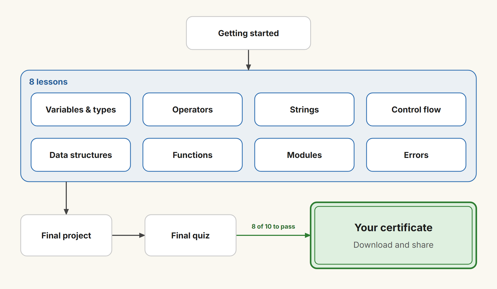
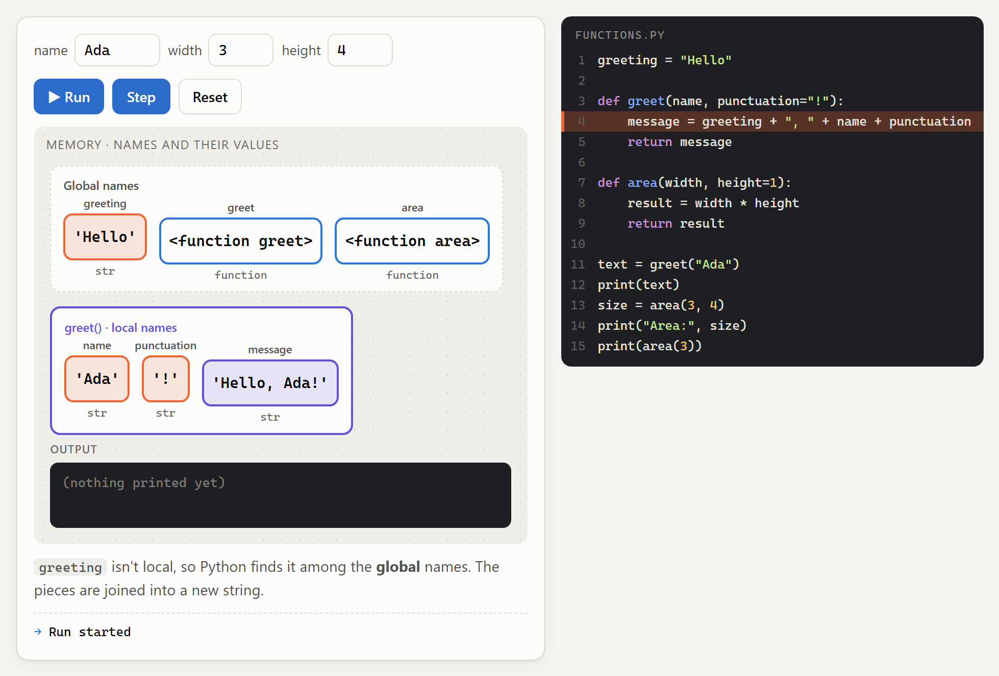
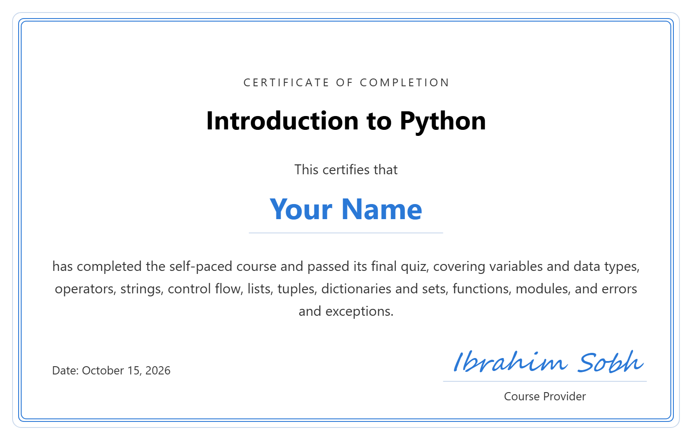

# Introduction to Python

A **self-paced online course, completely free**, that teaches you to write real Python programs from zero: variables and data types, operators, strings, decisions and loops, lists, tuples, dictionaries and sets, functions, modules, and errors and exceptions. It ends with a small project that uses everything you learned.

**The certificate is free too.** No sign-up and no fees: pass the final quiz and get a certificate with your name.

**Take the course:** https://ibrahimsobh.github.io/introduction-to-python/

## What you'll learn

1. **Getting Started**: what Python is, installing it, VS Code, PyCharm and Jupyter, scripts vs. the REPL, and your first `print()`
2. **Variables and Data Types**: naming rules, `int`, `float`, `str`, `bool`, `None`, type conversion and `input()`
3. **Operators and Expressions**: arithmetic, comparison and logical operators, and operator precedence
4. **Strings**: indexing and slicing, `split`, `join`, `replace`, `strip`, and f-strings
5. **Control Flow**: `if` / `elif` / `else`, `for`, `while`, `range()`, `break` and `continue`
6. **Data Structures**: `list`, `tuple`, `dict` and `set`, when to use each, and list comprehensions
7. **Functions**: defining and calling, parameters, default values, return values, and local vs. global scope
8. **Modules**: `import` styles, and practical use of `math`, `random` and `datetime`
9. **Errors and Exceptions**: reading tracebacks, `try` / `except` / `finally`, and basic debugging
10. **Final Project**: a quiz game that uses most of the course, which you can play right in the page

## What each lesson gives you

- **A clear description** of the idea, with an everyday example and tables of the key rules.
- **Real Python code** for every example, ready to copy and run yourself.
- **Figures of what's in memory**: every name and its value appears as a box, labelled with its type.
- **Interactive programs** that link the two: press Run or Step and watch the boxes change while the exact line of code doing it is highlighted, and the output appears in a console.
- **Hands-on tools**: a type explorer, an expression evaluator, a string slicer, a collections playground, a module explorer and a traceback reader.
- **A quiz in every lesson** (30 questions in total), plus a cheat sheet to revise from.

**Example: calling a function.** When `greet("Ada")` runs, a purple box of **local names** appears for the call, holding `name`, `punctuation` and the new `message`. Line 4 lights up in the code beside it, and the note explains that `greeting` is found among the global names. When the function returns, the box disappears.

**How long it takes:** about 5–6 hours if you're new to programming, or about 2–2.5 hours if you already program in another language.

| Part | New to programming | Already program |
|---|---|---|
| Getting Started (including installing Python) | 30–40 min | 10–15 min |
| Each of lessons 2–9 (theory, interactive programs, quiz) | 25–35 min | 10–15 min |
| Final project | 30 min | 15 min |
| Cheat sheet review | 10 min | 5 min |
| Final quiz and certificate | 15 min | 10 min |
| **Total** | **about 5–6 hours** | **about 2–2.5 hours** |

Finish with the final quiz: 10 simple questions. Score 8 of 10 or more to get a certificate with your name, which you can download as an image or save as a PDF and share.

**Here's what your certificate looks like:**

Everything runs in your browser. Nothing you enter, including your name, is sent anywhere.
